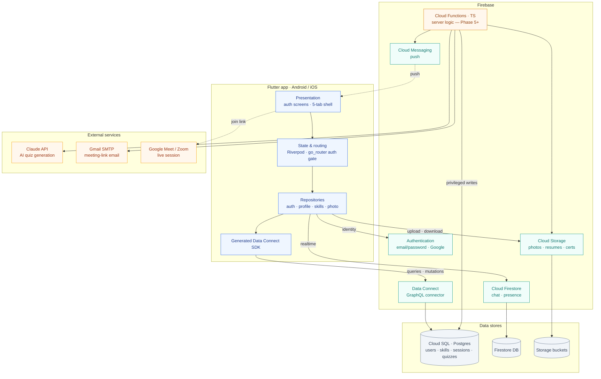

# SkillX — System Architecture

Peer skill-swapping app on a **hybrid Firebase backend**: structured data in Cloud SQL
through Firebase Data Connect, the realtime layer in Firestore, and privileged writes
reserved for Cloud Functions. Client is Flutter (Android / iOS), state via Riverpod +
`go_router`.

## How data flows

- **Structured data** — the app calls the generated Data Connect SDK; auth-scoped GraphQL
  operations (`dataconnect/connector/*.gql`) resolve to **Cloud SQL Postgres**.
- **Chat & presence** — Firestore realtime listeners (the one part that needs live updates;
  Data Connect has no subscriptions).
- **Files** — profile photos, resume PDFs and certificates in Cloud Storage.
- **Push** — FCM delivers request, session-start and quiz-ready alerts.
- **Server logic** — Cloud Functions run accept-request → session, meeting-link email
  (Gmail SMTP), AI quiz generation (Claude API) + grading, streak, module unlock, and
  certificate PDF issuance.

## Security model

- Data Connect operations are **auth-scoped** — a user only reads their own rows via
  `eq_expr: "auth.uid"`.
- `UserProgress` and `Certificate` are **server-write only** — no self-unlock or forgery.
- `QuizQuestion.correctIndex` is never returned to learner-facing queries; grading is server-side.
- Firestore chat is limited to the two participants (`firestore.rules`); Storage is owner-write
  (`storage.rules`).

## Component map

| Layer | Where it lives |
|-------|----------------|
| Flutter client | `app/lib/` — `core/` (router, theme, widgets), `features/*/` (presentation · application · data), `shared/` |
| Generated DC SDK | `app/lib/generated/dataconnect/` (from `firebase dataconnect:sdk:generate`) |
| Data Connect schema & ops | `dataconnect/schema/schema.gql`, `dataconnect/connector/{queries,mutations}.gql` |
| Firestore / Storage rules | `firestore.rules`, `firestore.indexes.json`, `storage.rules` |
| Cloud Functions | `functions/` — **not yet created** (arrives Phase 5) |

> Phase status: foundation + authentication are built. Requests, sessions, quizzes, rewards,
> dashboard, certificates and chat follow the roadmap in [DEVELOPMENT_PLAN.md](DEVELOPMENT_PLAN.md).
